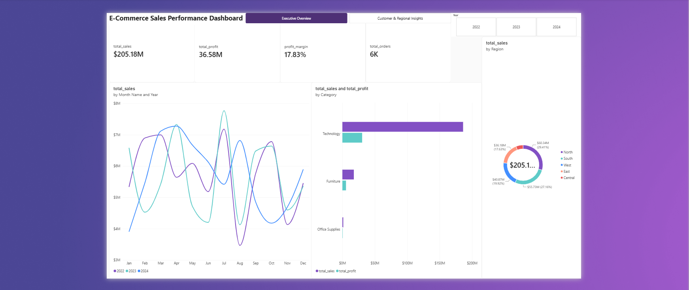
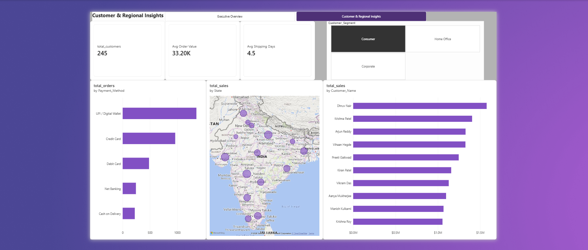

# 📊 E-Commerce & Retail Sales Performance Analytics Dashboard
> **End-to-End Business Intelligence Project built with Microsoft Power BI, Power Query, DAX, and Star Schema Data Modeling.**

[](https://powerbi.microsoft.com/)
[](https://learn.microsoft.com/en-us/dax/)
[](https://learn.microsoft.com/en-us/power-query/)
[](https://www.anudip.org/)

---

## 📸 Dashboard Preview

### 📌 Page 1: Executive Overview


### 📌 Page 2: Customer & Regional Insights


---

## 🎯 Business Problem Statement
Leadership and regional sales heads needed real-time visibility into multi-year retail transactions across India. Prior to this dashboard, operations faced challenges with:
- Fragmented reporting across 6,000+ orders across 29 Tier-1 and Tier-2 Indian cities.
- Hidden profit margin compression caused by unmonitored discounting in furniture product lines.
- Lack of geographic and customer segment purchasing insights.
- Untracked logistics shipping turnaround times.

---

## 📁 Repository Structure
```
├── e_commerce.pbix                        # Main Microsoft Power BI Dashboard File
├── e_commerce.pdf                         # Exported 2-Page Executive Dashboard PDF
├── ecommerce_sales_data.csv               # Cleaned Transactional Dataset (6,000 Rows)
├── dashboard_page1_executive_overview.png # Page 1 Visual Screenshot
├── dashboard_page2_customer_insights.png  # Page 2 Visual Screenshot
├── FINAL_PROJECT_REPORT.md                # In-depth Capstone Project Report
├── PROJECT_DOCUMENTATION.doc              # Formal Word Document for Submission
├── PROJECT_PRESENTATION_SLIDES.html       # 10-Slide Interactive Presentation Deck
└── README.md                              # Project Documentation Homepage
```

---

## 🏗️ Technical Architecture & Workflow

### 1. Data Cleaning & Transformation (Power Query)
- Enforced strict data typing across numeric currencies, integers, and temporal dimensions.
- Converted `Postal_Code` to **Text** to prevent mathematical aggregation and maintain code integrity.
- Feature-engineered a custom shipping duration column using M-Code:
  ```powerquery
  Duration.Days([Ship_Date] - [Order_Date])
  ```
- Validated 100% data hygiene with zero nulls, duplicate keys, or column distribution errors.

### 2. Dimensional Data Modeling (Star Schema)
- Built a dedicated **Date Dimension (`Dim_Date`)** spanning 2022 to 2024 using DAX `CALENDAR()`.
- Connected `Dim_Date[Date]` in a **1-to-Many (`1:*`)** single cross-filter relationship with `ecommerce_sales_data[Order_Date]`.
- Configured chronological month sorting (`Month Name` sorted by `Month Number`) to ensure proper time-series rendering from January to December.

### 3. DAX Measure Dictionary (`_Measures`)

| Measure Name | DAX Formulation | Business Objective |
|---|---|---|
| **Total Sales** | `SUM(ecommerce_sales_data[Sales_Amount])` | Total gross revenue ($205.18M) |
| **Total Profit** | `SUM(ecommerce_sales_data[Profit])` | Net profit after unit costs and discounts ($36.58M) |
| **Profit Margin %** | `DIVIDE([Total Profit], [total_sales], 0)` | Safe percentage division of business profitability (17.83%) |
| **Total Orders** | `DISTINCTCOUNT(ecommerce_sales_data[Order_ID])` | Total unique transactions (6,000) |
| **Avg Order Value (AOV)** | `DIVIDE([total_sales], [Total Orders], 0)` | Average revenue generated per customer order |
| **Total Customers** | `DISTINCTCOUNT(ecommerce_sales_data[Customer_ID])` | Unique purchasing customer accounts (450) |
| **Avg Shipping Days** | `AVERAGE(ecommerce_sales_data[Shipping_Days])` | Average logistics delivery SLA (4.4 Days) |

---

## 💡 Key Analytical Findings & Business Recommendations

1. **Q4 Festive Sales Surge**:
   - Monthly sales consistently surge by **~35% during October–December** across all three years due to Diwali and holiday shopping.
   - *Recommendation:* Lock supplier procurement 6–8 weeks in advance to avoid stockouts.

2. **The Furniture "Discount Trap"**:
   - Technology maintains healthy margins (~22%), but Furniture categories (Tables, Bookcases) experienced negative profit margins when discounts exceeded 25%.
   - *Recommendation:* Institute an automated discount cap of 20% on furniture.

3. **UPI Payment Dominance**:
   - Over **40% of all customer transactions** were completed via UPI / Digital Wallets, leading Credit Cards (28%).
   - *Recommendation:* Integrate 1-click UPI checkout to minimize cart abandonment.

4. **Regional Revenue Concentration**:
   - West (Maharashtra, Gujarat) and South (Karnataka, Tamil Nadu, Telangana) generate **~65% of overall national revenue**.
   - *Recommendation:* Expand regional micro-fulfillment centers in Mumbai and Bengaluru to shorten shipping SLAs below 2 days.

---

## 🚀 How to Run this Project Locally
1. Clone the repository:
   ```bash
   git clone https://github.com/harishmallipeddi/E-commerece-.git
   ```
2. Open **`e_commerce.pbix`** in **Microsoft Power BI Desktop**.
3. View the interactive slide deck by opening **`PROJECT_PRESENTATION_SLIDES.html`** in any browser.

---

## 👨‍💻 Author
**Harish Mallipeddi**  
*Data Analytics Trainee — Anudip Foundation*
